# Portfolio web · Santiago N. Stecklein

Trabajo final de **Diseño UX-UI 2026** (Licenciatura en Sistemas de Información, FCyT, Sede Concepción del Uruguay).

| | |
|---|---|
| **Sitio publicado** | https://santystecklein.github.io/portfolio-ux-ui/ |
| **Figma** (research, wireframes, design system, alta fidelidad y prototipo) | https://www.figma.com/design/RYawcZslY8qorWVFdVl4ay/Portfolio-Santiago-Stecklein---UX-UI |
| **Repositorio** | https://github.com/SantyStecklein/portfolio-ux-ui |

## Stack

- **HTML5 semántico** y **CSS3 puro** con variables `:root` que espejan las variables del Figma (colores, espaciado, radios y tipografías).
- **JavaScript vanilla** (sin frameworks): modo claro/oscuro, header con difuminado al scrollear, menú mobile accesible y envío del formulario.
- **Tipografías** (2 familias, `font-display: swap`): Sora y DM Sans, de Google Fonts.
- **Formspree** para el formulario de contacto.
- **GitHub Pages + GitHub Actions** para el despliegue automático.

## Estructura

```
index.html                    Página principal (9 secciones)
caso-mesa-de-ayuda.html       Caso de estudio desarrollado
404.html                      Página de error personalizada
css/styles.css                Tokens, base, componentes y secciones
js/main.js                    Interacciones
assets/                       Favicon e imágenes (WebP)
.github/workflows/pages.yml   Despliegue automático
```

## Proceso y decisiones de diseño

- **Usuario objetivo:** un/a Design Lead de un estudio que mira portfolios desde el celular y necesita ver, en menos de 30 segundos, quién soy, un caso con proceso, mis herramientas y cómo contactarme.
- **Concepto:** *Expresivo · Cercano · Ordenado*. Paleta azulada y discreta (fondo `#F5F8FD`, tinta `#17223B`, primario `#2D55D6`, con acentos celeste, arena y lavanda), tarjetas con borde marcado y una grilla estricta de espaciado en múltiplos de 8.
- **Figma y sitio coinciden:** el archivo de Figma incluye las versiones clara y oscura (modos de variables), el botón de tema sol/luna y un prototipo navegable en ambos modos, en desktop y mobile.
- **Orden de secciones:** Proyectos va antes que Skills, porque la prueba de lo que sé hacer es el proyecto. Es el único cambio respecto del orden de la referencia.
- **Accesibilidad (WCAG 2.2 AA):** contraste mínimo 4.5:1 verificado en ambos temas, enlace "Saltar al contenido", foco visible, menú con `aria-expanded` y `aria-controls`, errores de formulario anunciados, `prefers-reduced-motion` respetado.
- **Responsive:** mobile-first, probado en 320, 375, 414, 768, 1024, 1280 y 1440 px, sin scroll horizontal.
- **Extras:** modo claro/oscuro con toggle y `prefers-color-scheme`, formulario funcional con Formspree (con mensajes de validación y confirmación), email que se copia al portapapeles al tocar la dirección, página 404 personalizada y caso de estudio desarrollado.
- **Proyectos:** Mesa de Ayuda tiene caso de estudio propio; Cubrí Seguros y Landing Coffea enlazan a su sitio publicado y a su repositorio.

## Cómo desplegar (GitHub Pages)

1. Subir el proyecto a la rama `main` del repositorio.
2. En el repositorio: **Settings → Pages → Build and deployment → Source: GitHub Actions**.
3. Cada `push` a `main` ejecuta `.github/workflows/pages.yml` y publica el sitio.


## Créditos y recursos

- Tipografías: [Sora](https://fonts.google.com/specimen/Sora) y [DM Sans](https://fonts.google.com/specimen/DM+Sans) (Google Fonts, licencia OFL).
- **No se usaron templates.** El diseño, los componentes y el código son propios.
- Íconos del tema (sol y luna): SVG propios.
- Imágenes: capturas de mis proyectos, convertidas a WebP.

## Uso de IA

Usé Claude (Anthropic) como asistente. Qué se generó con su ayuda: el archivo de Figma, los borradores de los textos y el código HTML, CSS y JavaScript.
Cómo lo revisé: probé el sitio en el navegador, verifiqué los contrastes, corregí los textos para que reflejen lo que realmente hice y validé el diseño con 3 personas.

## Capturas

- Lighthouse (mobile): 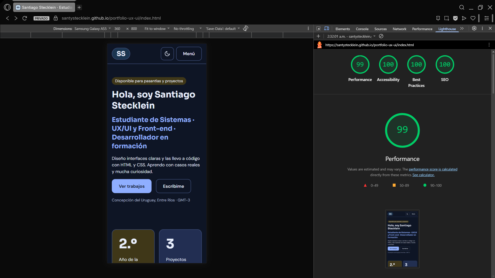
- Comparación Figma / sitio:

| Pantalla | Figma Desktop (1280 px) | Sitio Desktop (1280 px) |
|---|---|---|
| Figma / Sitio (Hero) | 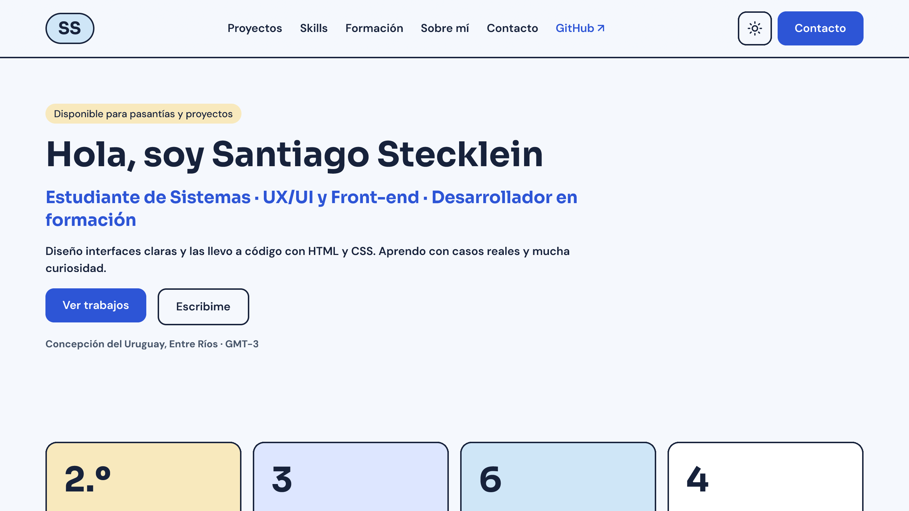 | 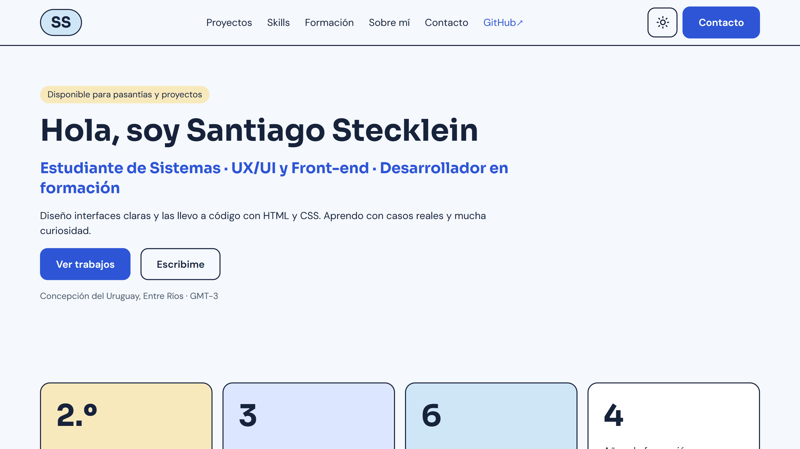 |
| Figma / Sitio (Proyectos) | 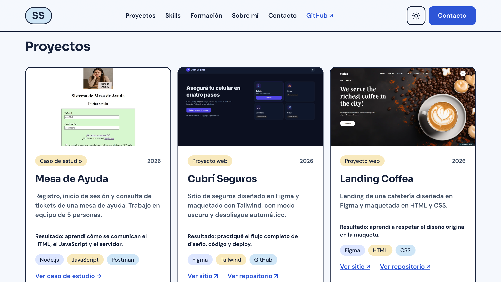 | 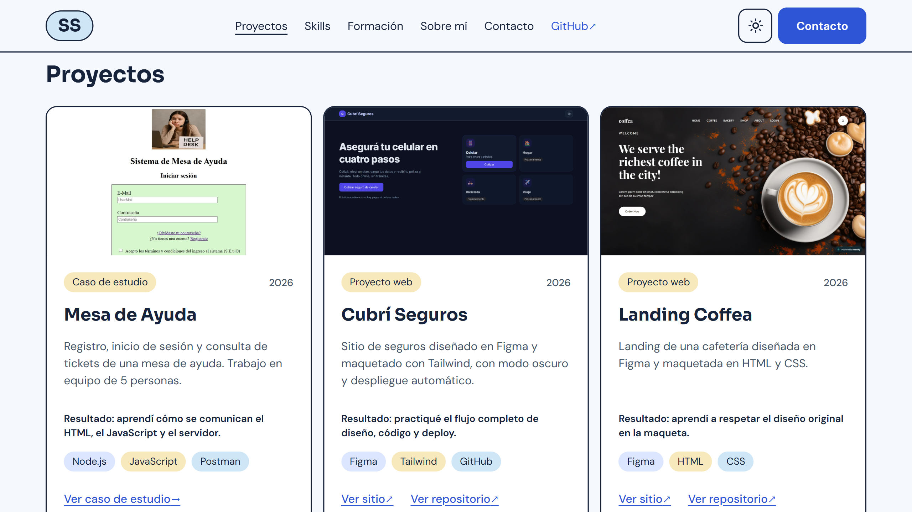 |
| Figma / Sitio (Proyectos Dark) | 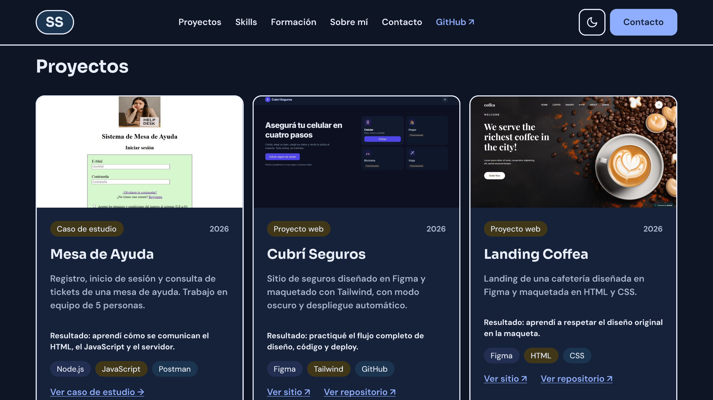 | 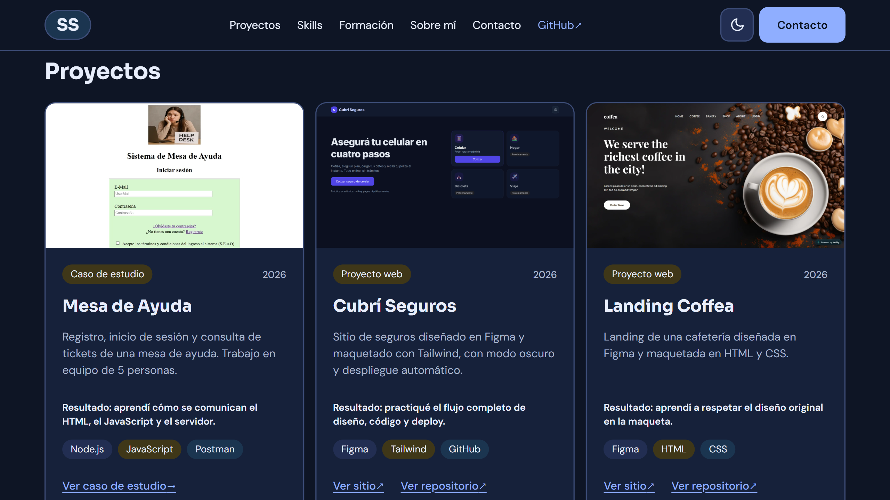 |

| Pantalla | Figma Mobile (375 px) | Sitio Mobile (375 px) |
|---|---|---|
| Figma / Sitio (Hero) | 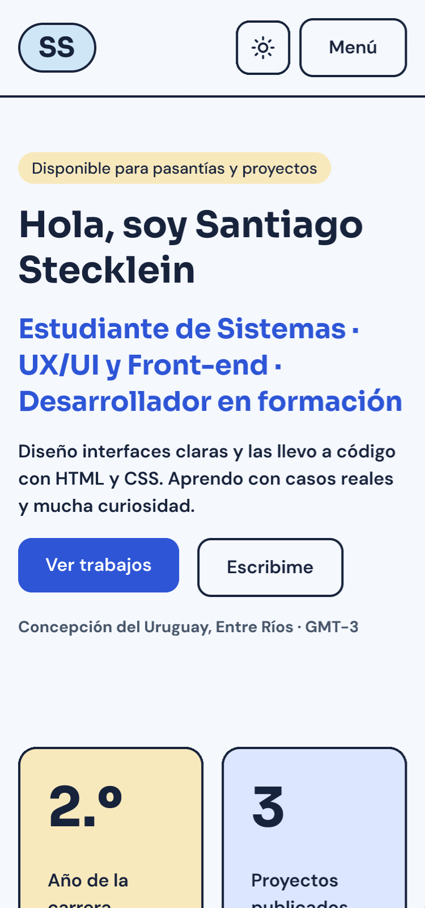 | 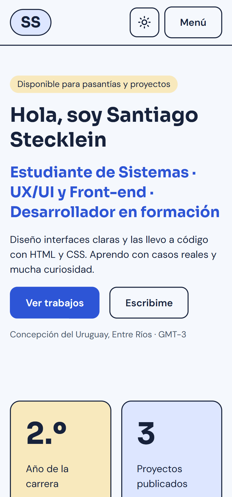 |
| Figma / Sitio (Proyectos) | 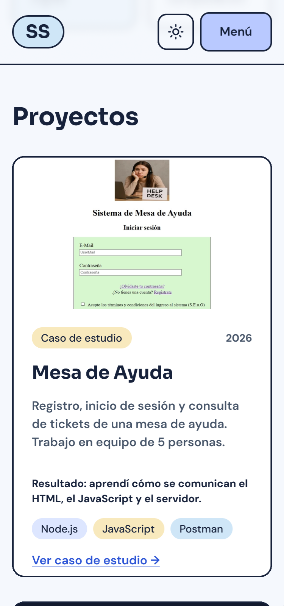 | 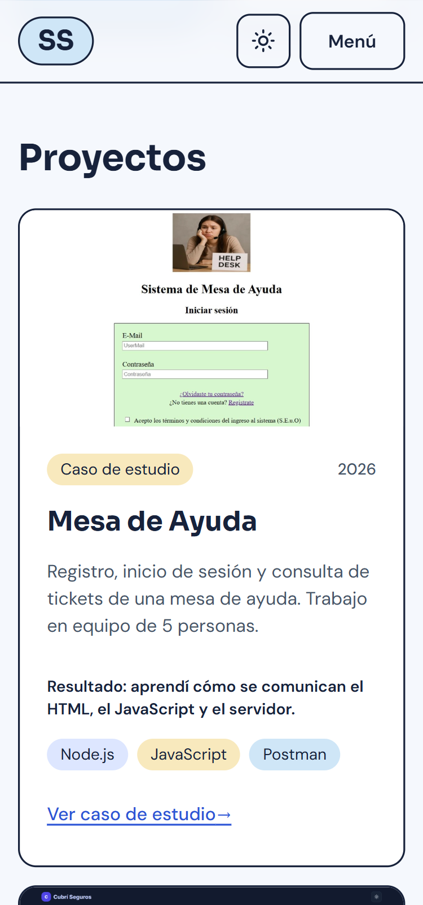 |
| Figma / Sitio (Proyectos Dark) | 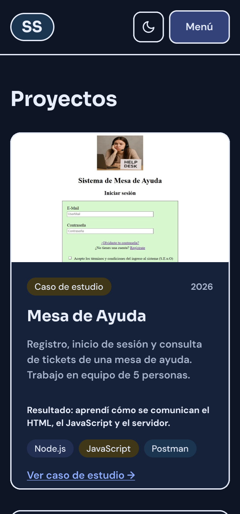 | 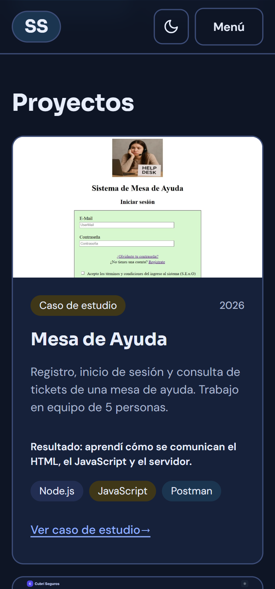 |

## Test de usabilidad

`[completar con los hallazgos y los cambios aplicados]`